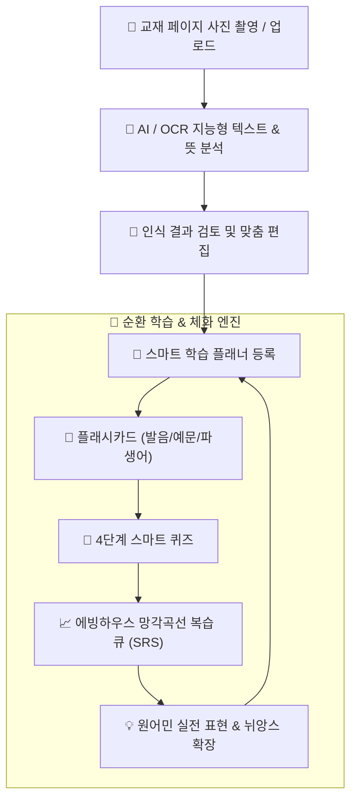
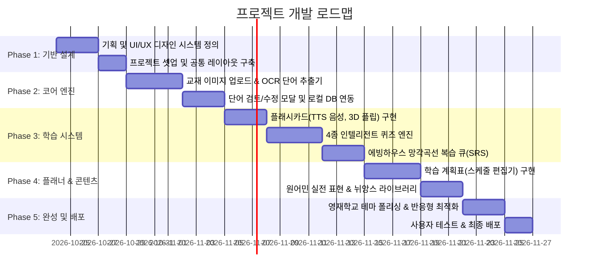

# 🎓 Veritas English (베리타스 잉글리시)
> **영재학교 아카데믹 스타일의 지능형 스마트 영어 학습 플랫폼 기획안**

---

## 1. 프로젝트 개요 (Overview)

### 1.1 프로젝트 목표
- **교재 사진 한 장으로 시작하는 지능형 단어 학습**: 교재나 시험지의 단어장 부분을 스마트폰/웹캠으로 캡처하면 단어·품사·뜻을 자동 인식하여 학습 계획에 즉시 반영.
- **영재학교·아이비리그 스타일의 단정하고 신뢰감 있는 UX/UI**: 산만함을 배제하고 학구적 몰입감을 극대화하는 정갈한 디자인 (Pretendard & Academic Serif).
- **초등생부터 성인까지 전 연령 대응**: 직관적인 인터페이스와 심도 있는 원어민 뉘앙스 학습을 동시에 지원.
- **에빙하우스 망각곡선 기반의 자동 순환 복습(SRS)** 및 **유연한 학습 스케줄러**.

---

## 2. 디자인 시스템: "영재학교 아카데믹 (Elite Academy)"

### 2.1 폰트 & 타이포그래피 (Typography)
- **국문/본문**: `Pretendard` (가독성이 극대화된 깔끔한 네오 그로테스크)
- **영문/헤드라인/브랜드**: `Merriweather` 또는 `Playfair Display` (지적이고 품격 있는 세리프)
- **코드/발음기호/라벨**: `JetBrains Mono` 또는 `Fira Code`
- **타이포 스케일**: 균형 잡힌 계층 구조(Hierarchy), 넉넉한 줄간격(Line-height: 1.6~1.7)으로 장시간 학습 시 눈의 피로 최소화.

### 2.2 컬러 팔레트 (Color Palette)
| 색상 구분 | 색상 코드 (HEX) | 의미 및 활용처 |
| :--- | :--- | :--- |
| **Academy Navy (Primary)** | `#0F172A` | 깊이 있는 지적 신뢰감, 헤더 및 주요 버튼 |
| **Oxford Blue (Secondary)** | `#1E3A8A` | 포인트 액센트, 활성화된 메뉴, 진행률 바 |
| **Ivory Warm White (Background)**| `#F8FAFC` ~ `#FDFBF7` | 눈이 편안한 미색 배경 (종이 질감 감성) |
| **Scholar Crimson (Accent)** | `#881337` / `#991B1B` | 오답 체크, 중요 단어 하이라이트 |
| **Sage Laurel (Success)** | `#065F46` | 완벽 암기 완료, 성취도 배지 |
| **Muted Slate (Text & Border)** | `#475569`, `#E2E8F0` | 세련되고 정돈된 카드 테두리 및 서브 텍스트 |

### 2.3 UI/UX 원칙
- **Distraction-Free (무결점 집중)**: 불필요한 화려한 애니메이션을 배제하고, 학습 본질에 집중할 수 있는 미니멀 카드 그리드.
- **Dual Mode Support**: 주간 학습 모드(Classic Paper White) & 야간 집중 모드(Oxford Dark Navy).
- **원클릭 인터랙션 & 키보드 숏컷**: 스페이스바(카드 뒤집기), 방향키(알아요/몰라요), 1~4 숫자키(퀴즈 풀기).

---

## 3. 핵심 기능 명세 (Core Features)

---

### [기능 1] 교재 캡처 OCR 단어 자동 등록 및 플래시카드/퀴즈 학습
1. **스마트 캡처 & OCR 엔진**
   - 교재의 단어 목록, 시험지, 프린트물을 카메라 촬영 또는 이미지 업로드(Drag & Drop).
   - **듀얼 OCR 파이프라인**:
     - *Client-side*: `Tesseract.js` (빠른 오프라인 무료 인식)
     - *AI Enhanced*: Gemini Vision API를 연동하여 표(Table), 번호 매김, 단어와 뜻의 좌우 분리, 품사(`n.`, `v.`, `a.`)를 정확하게 100% 구조화된 JSON으로 추출.
2. **단어장 등록 전 교정 모달**
   - 자동 추출된 `[단어 - 품사 - 한글 뜻 - 예문]` 목록을 테이블 형태로 미리보고 즉시 수정/삭제.
   - 단어 난이도(초등/중등/수능/토익/고급) 및 사용자 태그(예: `능률보카 3과`, `수능특강 12강`) 지정.
3. **플래시카드 (Flashcards)**
   - **앞면**: 단어, 발음기호, 원어민 발음 듣기(TTS), 품사.
   - **뒷면**: 한글 의미, 어원(Etymology), 유의어/반의어, 실전 예문.
   - 학습 반응: `안다 (Easy)` / `애매하다 (Good)` / `모른다 (Hard)` 3단계 평가로 SRS 주기 반영.
4. **인텔리전트 퀴즈 (Smart Quiz)**
   - 4지선다형 객관식 (뜻 맞히기 / 단어 맞히기)
   - 스펠링 빈칸 채우기 (Spelling Practice)
   - 리스닝 받아쓰기 (Dictation Drill)
   - 문장 완성 퀴즈 (Sentence Cloze)

---

### [기능 2] 원어민 실전 표현 & 어휘 뉘앙스 라이브러리 (Native Expression Lab)
1. **뉘앙스 비교 코너 (Nuance Distinction)**
   - 한국인이 가장 헷갈려하는 영단어 비교 (예: *Look vs See vs Watch*, *Subtle vs Nuance*, *Say vs Tell*).
   - 쉬운 상황별 비유와 삽화, 원어민이 실제로 느끼는 어감 차이 해설.
2. **실전 콜로케이션 & 구동사 (Collocations & Phrasal Verbs)**
   - 교과서 영어가 아닌 미국/영국 현지 일상에서 쓰는 자연스러운 덩어리 표현(Chunk).
   - 예: `make an effort`, `take into account`, `call it a day`, `hit the nail on the head`.
3. **상황별 실전 회화 카드 (Contextual Dialogue Cards)**
   - 비즈니스, 학교/아카데미, 식당/여행, 일상 스몰토크별 핵심 구문.
   - A-B 대화 롤플레잉 음성 듣기 기능.

---

### [기능 3] 망각곡선 기반 순환 복습 시스템 (Spaced Repetition System)
1. **라이트너 5단계 박스 (Leitner Box Model)**
   - **1단계**: 당일 학습 (1일 후 복습)
   - **2단계**: 3일 후 복습
   - **3단계**: 7일 후 복습
   - **4단계**: 14일 후 복습
   - **5단계**: 30일 후 마스터(Mastered) 보관함 이동
   - 틀린 단어는 즉시 1단계로 강등되어 재학습 큐에 등록.
2. **오답 노트 (Weakness Drill)**
   - 자주 틀리는 단어 Top 20 자동 분류.
   - "취약 단어만 모아 5분 번개 퀴즈" 기능 제공.
3. **망각 위험 알림**
   - 오늘 복습하지 않으면 잊어버릴 위험이 있는 단어 개수를 대시보드에 명확히 카운트다운 표시.

---

### [기능 4] 학습 계획서(플래너) 및 일정 편집기 (Curriculum Planner)
1. **목표 설정 위저드**
   - 일일 목표 단어 수 설정 (예: 10개, 20개, 30개).
   - 학습 기간 및 목표 시험일(D-Day) 지정.
2. **드래그 앤 드롭 스케줄러**
   - 캘린더 뷰 (월간 / 주간 / 일간 뷰).
   - 미룬 학습 일정이나 시험 대비 기간을 마우스 드래그로 손쉽게 재배치.
   - '휴식일(Rest Day)' 설정 시, 복습 주기가 밀리지 않도록 스마트 재분배.
3. **학습 통계 대시보드 (Scholar Analytics)**
   - 학습 스트릭(연속 출석일수), 누적 암기 단어 수, 퀴즈 정답률 그래프.
   - 영재학교 스타일의 '학업 성취 보고서(Study Report Card)' PDF 저장 및 인쇄 지원.

---

## 4. 추천 기술 스택 (Technology Stack)

| 영역 | 기술 스택 | 선정 이유 |
| :--- | :--- | :--- |
| **프론트엔드 프레임워크** | **React + Vite / Next.js (TypeScript)** | 빠르고 반응성 높은 SPA 구조, 타입 안정성 |
| **스타일링** | **Tailwind CSS + Lucide Icons** | 영재학교 스타일의 정돈된 유틸리티 디자인 구현 용이 |
| **UI 컴포넌트** | **Radix UI / Shadcn UI 기반** | 뛰어난 접근성(A11y), 키보드 탐색, 고급스러운 디자인 |
| **OCR 엔진** | **Tesseract.js & Gemini 1.5 Flash Vision** | Tesseract(기본 로컬 무료) + Gemini AI(교재 고난도 레이아웃 파싱) |
| **오디오 / TTS** | **Web Speech API (`speechSynthesis`)** | 외부 API 비용 없이 브라우저 내장 고품질 원어민 음성 즉시 재생 |
| **데이터 저장소** | **IndexedDB (Dexie.js) & LocalStorage** | 서버 없이도 브라우저에 단어장/학습기록 100% 안전 보관 (추후 Supabase 연동 가능) |
| **상태 관리** | **Zustand** | 가볍고 직관적인 단어장 및 플래너 상태 관리 |

---

## 5. 단계별 개발 로드맵 (Development Roadmap)

---

## 6. 기대 효과 및 차별점

1. **학습 진입 장벽 제거**: 교재를 일일이 손으로 타이핑할 필요 없이 사진 한 번으로 나만의 디지털 단어장 완성.
2. **지속 가능한 복습**: 작심삼일로 끝나지 않도록 시스템이 알아서 망각 위험 단어를 매일 추천.
3. **품격 있는 학습 환경**: 게임 같은 유치한 그래픽 대신, 초등학생도 진지하게 몰입하고 성인도 자부심을 갖고 쓰는 명문 아카데믹 스타일 UI 제공.
4. **단어에서 표현으로의 확장**: 단순 단어 암기에 그치지 않고 원어민 뉘앙스와 실전 표현까지 자연스럽게 연결.
